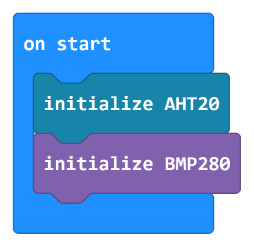

# AHT20 and BMP280 for micro:bit MakeCode

Blocks for an AHT20 temperature/humidity sensor and BMP280 temperature sensor. The BMP280 code implements temperature only, like the supplied MicroPython example. Pressure is not implemented.

## Wiring

Connect both sensors to the same I²C bus:

| Sensor pin | micro:bit |
| --- | --- |
| VCC / VIN | 3V |
| GND | GND |
| SDA | P20 |
| SCL | P19 |

Use 3.3 V-compatible breakout boards. I²C needs pull-ups to 3.3 V; breakout boards often include them. Check your hardware documentation.

AHT20 uses address 0x38. BMP280 is detected at 0x76 or 0x77 and must report chip ID 0x58; a BME280 is not supported.

## Installation

Open the [micro:bit MakeCode editor](https://makecode.microbit.org/#editor), select **Extensions**, and paste `https://github.com/rlangoy/pxt-aht20-bmp280` into the search box. Select the extension to add the **AHT20** and **BMP280** categories.

## Blocks

Drag `initialize AHT20` or `initialize BMP280` from its sensor category into `on start`. If you use both sensors, stack both blocks there. You can also skip this step and let the first `read sensor` initialize the sensor automatically.

`read sensor` returns true on success and updates the values. Read the temperature or humidity block only after a successful read. Values initially equal zero and retain their last successful reading on failure. Wait at least two seconds between AHT20 readings.

The BMP280 reads its individual temperature calibration values and uses the floating-point compensation formula. MakeCode's I²C interface does not expose a reliable device-presence scan or all bus errors, so the return values cannot guarantee detection of every wiring fault. I²C does not work in the simulator.

## Example

**1. Initialize both sensors.** In **Blocks**, drag one initialization block from each sensor category into **on start**.

**2. Read the sensors in a loop.** Inside **forever**, add one **if / else** from **Logic** for each sensor. Use **read AHT20 sensor** and **read BMP280 sensor** as the conditions. Under **Advanced → Serial**, use **serial write value** for the readings and **serial write line** for a failed read. End the loop with a 2000 ms pause from **Basic**.

**3. View the readings.** Download the program to the wired micro:bit, connect it by USB, and open **Show console Device** in MakeCode to see the readings.

## Gallery submission

For gallery approval see https://makecode.microbit.org/extensions/approval. Add an MIT LICENSE and complete the other approval requirements if you wish to submit the extension. Check the rights to any third-party code before licensing it.
