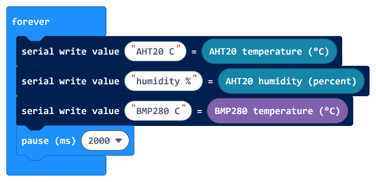

# AHT20 and BMP280 for micro:bit MakeCode

Blocks for an AHT20 temperature/humidity sensor and BMP280 temperature sensor. The BMP280 code implements temperature only, like the supplied MicroPython example. Pressure is not implemented.

## Wiring

Connect both sensors to the same I²C bus:

| Sensor pin | micro:bit |
| --- | --- |
| VCC / VIN | 3V |
| GND | GND |
| SDA | P20 |
| SCL | P19 |

Use 3.3 V-compatible breakout boards. I²C needs pull-ups to 3.3 V; breakout boards often include them. Check your hardware documentation.

AHT20 uses address 0x38. BMP280 is detected at 0x76 or 0x77 and must report chip ID 0x58; a BME280 is not supported.

## Installation

Open the [micro:bit MakeCode editor](https://makecode.microbit.org/#editor), select **Extensions**, and paste `https://github.com/rlangoy/pxt-aht20-bmp280` into the search box. Select the extension to add the **AHT20** and **BMP280** categories.

## Blocks

Each temperature or humidity block reads its sensor when it runs. The first use initializes the sensor automatically. You can also drag `initialize AHT20` or `initialize BMP280` into `on start`.

Temperature is in degrees Celsius and relative humidity is in percent. All three blocks return numbers rounded to the nearest hundredth. MakeCode can omit trailing zeros when displaying a number. If a read fails, the block returns the last successful value for that measurement, or zero before the first successful read.

The BMP280 reads its individual temperature calibration values and uses the floating-point compensation formula. MakeCode's I²C interface does not expose a reliable device-presence scan or all bus errors, so the return values cannot guarantee detection of every wiring fault. I²C does not work in the simulator.

## Example

**1. Optionally initialize both sensors at startup.** In **Blocks**, drag one initialization block from each sensor category into **on start**.

**2. Read the sensors in a loop.** Inside **forever**, add three **serial write value** blocks from **Advanced → Serial**. Plug the AHT20 temperature, AHT20 humidity, and BMP280 temperature blocks directly into their value slots. End the loop with a 2000 ms pause from **Basic**.

**3. View the readings.** Download the program to the wired micro:bit, connect it by USB, and open **Show console Device** in MakeCode to see the readings.

## Diagnosing zero readings

If a reading stays at zero, download the [sensor diagnostic HEX](https://raw.githubusercontent.com/rlangoy/pxt-aht20-bmp280/main/docs/diagnostics/microbit-sensor-diagnostic-299acfd.hex) and copy it to the `MICROBIT` drive. This replaces the program on the board. Open the device serial console to see the AHT20 status, the chip IDs at both BMP280 addresses, and the three labeled readings. `AHT init` and `BMP init` each print `1` when initialization succeeds or `0` when it fails.

## Gallery submission

For gallery approval see https://makecode.microbit.org/extensions/approval. Add an MIT LICENSE and complete the other approval requirements if you wish to submit the extension. Check the rights to any third-party code before licensing it.
